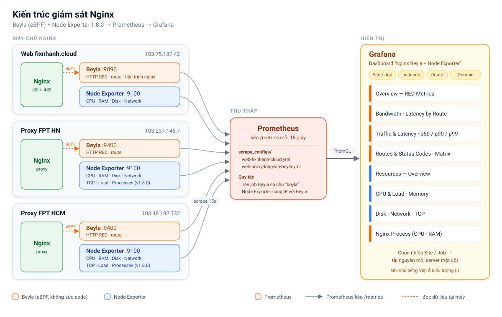

# Hướng Dẫn Chi Tiết Cài Đặt Giám Sát Nginx bằng Grafana Beyla & Prometheus

Tài liệu này hướng dẫn chi tiết từng bước để thiết lập hệ thống giám sát tự động (auto-instrumentation) cho máy chủ Nginx (website `scan.lazyy.site`) sử dụng eBPF với Grafana Beyla, kết hợp cùng Prometheus và Grafana.



---

## Bước 1: Cấu hình Grafana Beyla

Grafana Beyla sử dụng eBPF để tự động thu thập các số liệu (metrics) và dấu vết (traces) từ ứng dụng mà không cần sửa đổi mã nguồn.

1.  Đảm bảo bạn đã cài đặt tệp thực thi `beyla` (thường ở đường dẫn `/usr/local/bin/beyla`).
2.  Tạo hoặc chỉnh sửa tệp cấu hình `/etc/beyla/beyla-config.yml` với nội dung sau:

```yaml
# /etc/beyla/beyla-config.yml
# Grafana Beyla: giám sát Nginx bằng eBPF, xuất metrics cho Prometheus.
# Sau khi sửa: sudo systemctl restart beyla

log_level: INFO          # DEBUG khi cần dò lỗi
print_traces: false      # true = in từng request ra journal (chỉ bật khi debug)

# ---------------------------------------------------------------------------
# 1. Tiến trình cần theo dõi
# ---------------------------------------------------------------------------
executable_name: nginx   # Tên tiến trình
open_port: 80,443        # Cổng nginx đang lắng nghe

# ---------------------------------------------------------------------------
# 2. Xuất metrics cho Prometheus
# ---------------------------------------------------------------------------
prometheus_export:
  # Nếu Prometheus chạy cùng máy (mặc định cũng dùng 9090) thì đổi cổng này,
  # ví dụ 9400, và sửa target của job 'beyla-nginx' trong prometheus-scrape.yml.
  port: 9090
  path: /metrics
  report_target: true
  report_peer: true
  features:
    - application            # Metrics HTTP: request, latency, status code, body size
    - application_process    # CPU / RAM / số tiến trình nginx (hàng "Tiến trình Nginx")
  # Mốc histogram (giây) cho latency p50 / p90 / p99 và heatmap
  buckets:
    duration_histogram: [0, 0.005, 0.01, 0.025, 0.05, 0.075, 0.1, 0.25, 0.5, 0.75, 1, 2.5, 5, 7.5, 10]

# ---------------------------------------------------------------------------
# 3. Gom URL thành route (nhãn http_route trên dashboard)
# ---------------------------------------------------------------------------
routes:
  # Đặt tên route rõ ràng: {slug} / {file} = một đoạn URL bất kỳ.
  # Ví dụ cho site Next.js (fixnhanh.cloud) - sửa theo URL thật của từng site.
  patterns:
    - /_next/static/chunks/{file}
    - /_next/static/media/{file}
    - /_next/image
    - /posts/{slug}
    - /category/{slug}
    - /uploads/{file}
  # URL không khớp patterns ở trên:
  # heuristic: tự thay đoạn URL giống ID bằng '*' để nhãn http_route không bị
  # bùng nổ (dashboard Matrix lọc theo dạng "/*/client/...")
  unmatched: heuristic
  # Bỏ không đếm các request kiểm tra sức khỏe / scrape
  ignored_patterns:
    - /nginx_status
    - /health
    - /metrics
  ignore_mode: all

# ---------------------------------------------------------------------------
# 4. Nhãn gắn vào metrics
# ---------------------------------------------------------------------------
attributes:
  kubernetes:
    enable: false
  # Thêm nhãn server_address (tên miền) cho biến "Domain (Website)" trên dashboard.
  # Bỏ client_address và url_path vì mỗi IP khách / mỗi URL sẽ tạo một chuỗi
  # metrics riêng (dùng http_route đã gom nhóm thay cho url_path).
  select:
    http_server_request_duration:
      include: ["*"]
      exclude: ["client_address", "url_path"]
    http_server_request_body_size:
      include: ["*"]
      exclude: ["client_address", "url_path"]
    http_server_response_body_size:
      include: ["*"]
      exclude: ["client_address", "url_path"]
  # Tên dịch vụ để nhận diện nginx instance này
  global:
    "service.name": "scan.lazyy.site"
    "service.namespace": "lazyy-site"
```

## Bước 2: Thiết lập Systemd Service cho Beyla

Để đảm bảo Beyla luôn chạy ngầm và tự động khởi động cùng hệ thống, chúng ta cần tạo một systemd service.

1.  Tạo tệp `/etc/systemd/system/beyla.service` với nội dung:

```ini
[Unit]
Description=Grafana Beyla eBPF Auto-instrumentation
Documentation=https://grafana.com/docs/beyla/
After=network-online.target nginx.service
Wants=network-online.target nginx.service

[Service]
Type=simple
# eBPF yêu cầu quyền root hoặc CAP_SYS_ADMIN
User=root
ExecStart=/usr/local/bin/beyla --config /etc/beyla/beyla-config.yml
Restart=always
RestartSec=5
# Kernel cũ (< 5.11) cần bỏ giới hạn locked memory để nạp eBPF map
LimitMEMLOCK=infinity
LimitNOFILE=65536

[Install]
WantedBy=multi-user.target
```

2.  Kích hoạt và khởi động dịch vụ:

```bash
sudo systemctl daemon-reload
sudo systemctl enable beyla.service
sudo systemctl start beyla.service
sudo systemctl status beyla.service # Kiểm tra trạng thái xem dịch vụ đã hoạt động chưa
```

3.  Kiểm tra Beyla đã xuất metrics (truy cập web vài lần trước để có dữ liệu):

```bash
curl -s localhost:9090/metrics | grep -E '^http_server_request_duration_seconds_count' | head -3
curl -s localhost:9090/metrics | grep -E '^process_(cpu_time|memory_usage)' | head -3
journalctl -u beyla -n 50 --no-pager   # Xem log nếu không có dữ liệu
```

> Dòng `http_server_...` phải có nhãn `http_route` và `server_address`. Dòng `process_...` có nghĩa là feature `application_process` đã chạy.

## Bước 3: Cấu hình Node Exporter (Giám sát tài nguyên máy chủ)

Node Exporter giúp thu thập các số liệu về CPU, RAM, Disk, Network của máy chủ.

1. Tải và giải nén Node Exporter:
```bash
wget https://github.com/prometheus/node_exporter/releases/download/v1.8.0/node_exporter-1.8.0.linux-amd64.tar.gz
tar xvfz node_exporter-1.8.0.linux-amd64.tar.gz
sudo mv node_exporter-1.8.0.linux-amd64/node_exporter /usr/local/bin/
```

2. Tạo systemd service cho Node Exporter (`/etc/systemd/system/node_exporter.service`):
```ini
[Unit]
Description=Node Exporter
After=network.target

[Service]
User=root
ExecStart=/usr/local/bin/node_exporter
Restart=always

[Install]
WantedBy=multi-user.target
```

3. Khởi động Node Exporter:
```bash
sudo systemctl daemon-reload
sudo systemctl enable node_exporter
sudo systemctl start node_exporter
```

## Bước 4: Cấu hình Prometheus

Tiếp theo, bạn cần cấu hình máy chủ Prometheus của mình để nó thu thập dữ liệu từ Beyla và Node Exporter.

1.  Mở tệp cấu hình của Prometheus (thường là `/etc/prometheus/prometheus.yml`).
2.  Thêm khối cấu hình sau vào dưới phần `scrape_configs`:

```yaml
scrape_configs:
  # ... các cấu hình scrape hiện có ...

  - job_name: 'beyla-nginx'
    # Thu thập dữ liệu mỗi 15 giây (điều chỉnh theo nhu cầu của bạn)
    scrape_interval: 15s
    static_configs:
      - targets: ['localhost:9090'] # Giả định Beyla chạy trên cùng server với Prometheus.
        labels:
          environment: 'production'
          domain: 'scan.lazyy.site'

  - job_name: 'node_exporter'
    scrape_interval: 15s
    static_configs:
      - targets: ['localhost:9100']
        labels:
          environment: 'production'
          domain: 'scan.lazyy.site'
```

3.  Khởi động lại hoặc reload dịch vụ Prometheus:

```bash
sudo systemctl reload prometheus
# hoặc
sudo systemctl restart prometheus
```

## Bước 5: Thiết lập Dashboard trên Grafana

1.  Đăng nhập vào giao diện Grafana của bạn.
2.  Đi tới phần **Dashboards** > **Import**.
3.  Bấm **Upload dashboard JSON file** và chọn tệp `grafana-dashboard-beyla-nginx.json` trong thư mục này
    (hoặc mở tệp, copy toàn bộ nội dung và dán vào khung Import).

### Các nhóm panel tài nguyên (Node Exporter + Beyla)

Bên dưới các panel HTTP, dashboard có thêm 6 hàng giám sát tài nguyên:

| Hàng | Panel | Nguồn |
|------|-------|-------|
| Resources — Overview | Server Overview: Uptime, CPU Cores, RAM Total, CPU Busy, RAM Used, Disk / Used, Swap Used, Load 1m / Core, Nginx Processes | Node Exporter + Beyla |
| Resources — CPU & Load | CPU theo mode (user/system/iowait/steal...), Load Average 1/5/15 so với số core | Node Exporter |
| Resources — Memory | RAM & Swap %, Memory chi tiết (Used / Buffers+Cache / Free / Total) | Node Exporter |
| Resources — Disk | Dung lượng % và dung lượng trống theo mount point, Disk Usage theo thời gian, Disk I/O Utilization, Throughput, IOPS | Node Exporter |
| Resources — Network | Traffic theo card mạng, Errors & Drops, TCP Connections (established / time_wait / in use) | Node Exporter |
| Resources — Nginx Process (Beyla) | CPU và RAM (RSS) của nginx | Beyla (`application_process`) |

> Hàng **Resources — Nginx Process** chỉ có dữ liệu khi `beyla-config.yml` có `application_process` trong `features` (Bước 1). Sau khi sửa, chạy `sudo systemctl restart beyla`.

Sau khi Import, chọn Data Source là Prometheus của bạn để hoàn tất. Bạn sẽ bắt đầu thấy các số liệu về lưu lượng, độ trễ và các lỗi từ web scan.lazyy.site của mình!
